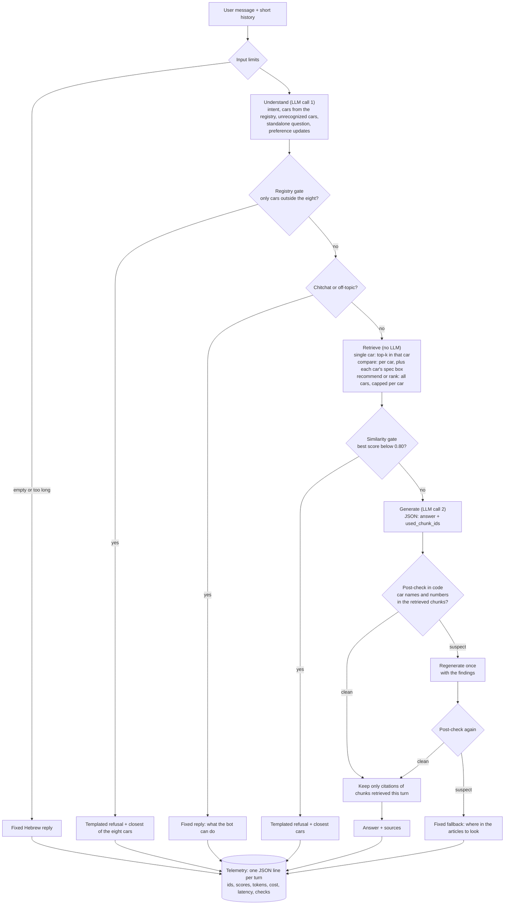

# carwise

A Hebrew chatbot that answers questions about eight cars using only eight road-test articles
from auto.co.il. It compares cars and picks up your preferences as the conversation goes. When the
articles don't cover a question, it says so and points to what they do cover. Built as a
take-home proof of concept, not as production software.

## TL;DR

**Approach.** Controlled retrieval-augmented generation (RAG) with a fixed pipeline and no agent
loop. The model writes the answer, and code decides what goes into the model and what may come out.

**Architecture in five lines.**
1. Ingestion (once): fetch the eight articles politely, clean them, chunk by headings, embed
   locally (`multilingual-e5-large`) into a local Chroma index.
2. Understand (LLM call 1): one structured call returns the intent, the cars (resolved against a car
   registry), a standalone question and preference updates.
3. Retrieve and gate (no LLM): per-car retrieval. Code refuses a car outside the eight, and
   off-topic messages, before any generation call.
4. Generate (LLM call 2): JSON with the answer and the ids of the chunks it used. Code checks the
   ids, the car names and every number against the retrieved chunks. A suspect answer is
   regenerated once, then replaced by a fixed reply.
5. Telemetry: one JSON line per turn (chunk ids, scores, tokens, cost, latency, check results),
   never the message text.

**Three key decisions.**
1. **The registry gate, not a similarity threshold, does the refusing.** On this corpus,
   similarity scores do not separate answerable questions from unanswerable ones
   ([ADR 0003](docs/decisions/0003-retrieval-tuning.md)), so a car outside the eight is refused
   in code, before generation.
2. **Post-checks in code.** Every car name and every number in an answer must appear in the
   chunks retrieved for that turn; an answer that fails is regenerated once, then replaced.
3. **Measure before changing.** The embedding model, the retrieval settings and the generate
   prompt were each chosen from an eval run, and a prompt change that lost accuracy was rolled
   back ([ADR 0004](docs/decisions/0004-answer-eval-and-generate-prompt.md)).

On the `final` profile, 3 runs of 23 tuning questions passed 64 of 69, and 6 questions written
after tuning passed 15 of 18 (details under [Evaluation](#evaluation)).

## Contents

- [What it is, and what it is not](#what-it-is-and-what-it-is-not)
- [Quickstart](#quickstart)
- [Architecture](#architecture)
- [Key decisions](#key-decisions)
- [Guardrails and reliability](#guardrails-and-reliability)
- [Evaluation](#evaluation)
- [Example conversation](#example-conversation)
- [Deliberately not built](#deliberately-not-built)
- [Known limitations and next steps](#known-limitations-and-next-steps)
- [Production path (AWS)](#production-path-aws)
- [Data and licensing](#data-and-licensing)
- [Project process](#project-process)
- [Assumptions](#assumptions)
- [Notes](#notes)

## What it is, and what it is not

**It is** a chatbot that answers in Hebrew about these eight cars, from these eight
articles:

| Car | Article |
|---|---|
| Citroën C3 (2026) | road test |
| Audi RS3 (facelift) | road test |
| Kia EV9 | long-term report |
| MG S6 | road test |
| Hyundai Elantra N (manual) | road test |
| GAC Aion HT | road test |
| Lynk & Co 01 (2026) | road test |
| Genesis GV80 (2026) | road test |

The source URLs are in [`config/cars.yaml`](config/cars.yaml), the car registry. It also lists
each car's Hebrew and Latin-script aliases, body type and powertrain, and it is the single source
for car names in ingestion, the understand prompt, the gate and the post-check.

**It is not** a general car advisor. It does not know prices, models or facts that are not in the
eight articles, and it does not use the model's own knowledge to fill gaps. When you ask about a
car outside the eight (for example a Toyota), it says the articles don't cover it and suggests the
closest of the eight. When you ask about a detail an article never mentions, it says the detail is
not mentioned and offers the nearest facts the article does contain. The interface is Hebrew
only: questions, answers, refusals and the UI.

It keeps preferences (budget, powertrain, passengers, priorities) for one conversation only.
Nothing is stored between sessions.

## Quickstart

Requirements: Python 3.11 or newer and [uv](https://docs.astral.sh/uv/). The first ingest downloads
the embedding model (about 2.2 GB) and the eight articles.

### Local (uv)

```bash
uv sync
uv run python -m app ingest
cp .env.example .env            # then put your key in OPENAI_API_KEY (PowerShell: copy .env.example .env)
uv run --env-file .env python -m app chat
```

- `ingest` fetches the eight articles into `data/raw/`, cleans and chunks them, and builds the
  index in `data/index/`. A second run uses the cache and works offline.
- `chat` is the command-line chat. Type `/prefs` to see the inferred preferences, `/reset` to
  start a new conversation and `/exit` to leave. Most terminals print Hebrew left to right, so
  the words are right but a line that mixes Hebrew and Latin may look out of order. The web UI
  renders right to left.
- The web UI: `uv run --env-file .env python -m app ui`, then open http://localhost:8501. It
  listens on localhost only.
- Profiles: `dev` (default) uses `gpt-5.4-nano` for both calls; `--profile final` uses nano for
  understanding and `gpt-5.4-mini` for generation. The published numbers are from `final`.
- The `Makefile` wraps the same commands (`make ingest`, `make chat`, `make ui`, `make eval`,
  `make test`, `make lint`). It does not read `.env`, so export `OPENAI_API_KEY` in your shell
  first.

### Docker

```bash
docker build -t carwise .
docker run --rm -e OPENAI_API_KEY -v carwise-data:/app/data -p 8501:8501 carwise
```

Set `OPENAI_API_KEY` in your shell first. `-e OPENAI_API_KEY` passes it by name, so the key is
not typed on the command line or stored in the image. Open http://localhost:8501. The first
start fetches the articles, downloads the embedding model and builds the index into the
`carwise-data` volume while the page shows a loading message (177 s on the development machine).
Later starts reuse the volume (17 s). Add `-e CARWISE_PROFILE=final` for the `final` profile.
Details and measurements: [docs/docker.md](docs/docker.md).

### Ollama (optional, not evaluated)

The LLM client speaks the OpenAI Chat Completions API with a configurable `base_url`, so any
OpenAI-compatible server can replace OpenAI. Ollama was used only to check that the path works
end to end, with one question answered by `qwen3:4b-instruct-2507-q4_K_M`. **Its Hebrew answer
quality was not evaluated**, and no Ollama numbers are reported. To try it:

1. Copy `config/settings.yaml` to a file of your own (for example `settings.local.yaml`).
2. In the copy, add a profile and give the model a zero price (the client refuses a model that
   has no price):

   ```yaml
   profiles:
     ollama:
       base_url: http://localhost:11434/v1
       understand_model: qwen3:4b-instruct-2507-q4_K_M
       generate_model: qwen3:4b-instruct-2507-q4_K_M
   prices:
     qwen3:4b-instruct-2507-q4_K_M: { input: 0, cached_input: 0, output: 0 }
   ```

3. Run from the repository root, with no `OPENAI_API_KEY` set:
   `CARWISE_CONFIG=settings.local.yaml uv run python -m app chat --profile ollama`

### What needs an API key, and what it costs

| Command | Needs `OPENAI_API_KEY` | Cost |
|---|---|---|
| `python -m app ingest` | no | free (local embeddings) |
| `uv run pytest` | no | free, offline (fake LLM, fake embedder) |
| `python -m app eval` (retrieval level) | no | free: replays recorded understand outputs |
| `python -m app chat`, `python -m app ui` | yes | see below |
| `python -m app eval --level answer` | yes | about $0.25 for answers and $0.20 for the judge per 3-run eval on `final` |

Measured cost: one 3-run answer eval on `final` (69 graded questions, every turn included) cost
$0.2447 for the answers (400,092 input and 18,764 output tokens) and $0.2017 for the judge. The
6-question hold-out, 3 runs, cost $0.0409. Prices per model are in
[`config/settings.yaml`](config/settings.yaml), checked against OpenAI's pricing page
([ADR 0001](docs/decisions/0001-llm-sampling-controls.md)). Every chat session stops at
`llm.max_cost_usd` ($2.00). In the UI that cap applies to one browser session, not to the whole
process.

## Architecture

Two phases. **Ingestion** runs once (`python -m app ingest`). **Conversation** runs the same
fixed steps for every message, in [`src/carwise/pipeline.py`](src/carwise/pipeline.py), the only
module that orchestrates. The CLI, the Streamlit UI and the eval runner all call that one
function and hold no logic of their own.



The LLM is used in exactly two places per turn. Chunking, embedding, retrieval, both gates, the
post-check, citations and logging are plain code or a small local embedding model. When a gate
refuses, the generation call never happens.

**Ingestion.** [`src/carwise/ingest/`](src/carwise/ingest/) fetches the eight URLs from the
registry with an identifiable User-Agent, a 3 s delay and `robots.txt` respected, and caches the
HTML. It keeps only the article body, chunks it by headings and paragraphs (78 chunks, none over
the embedding model's 512-token window), and attaches `car`, `section`, `source_url` and
`chunk_id` to every chunk. Chunks are embedded with `intfloat/multilingual-e5-large` at a pinned
revision and stored in a local Chroma collection.

**Why a fixed pipeline and not an agent.** The task has one data source and one kind of
question. The steps are always the same: understand, retrieve, check, answer. A fixed order is
what lets code put a deterministic check at each point where a model can go wrong: the
registry gate runs before generation, and the post-check runs after it. An agent that chooses
its own tools and steps would make those points optional, cost a variable number of calls per
turn, and be harder to evaluate. An agent loop becomes worth it when the bot needs tools whose
use cannot be planned, such as live prices or external search; see the Backlog in
[`BOARD.md`](BOARD.md).

## Key decisions

ADRs hold the measurements; [docs/README.md](docs/README.md) indexes them.

| Decision | Evidence | Alternative rejected | Would change when |
|---|---|---|---|
| Fixed RAG pipeline, two LLM calls per turn | The flow is linear; every guardrail sits at a fixed point | Agent loop with tools | Live data or external tools are needed |
| One structured understand call (intent, cars, rewrite, preferences) | One call instead of three components; the registry in the prompt resolves Hebrew and Latin aliases | Separate classifier, extractor and rewriter | One of the fields needs a different model |
| Sampling: temperature 0, seed 7, `reasoning_effort: none` ([ADR 0001](docs/decisions/0001-llm-sampling-controls.md)) | Both models accept all three; `low` effort adds 17 to 32 reasoning tokens billed as output; `minimal` is rejected | Low reasoning effort as the fallback CLAUDE.md allowed for | A model rejects a control, or the eval shows reasoning fixes real failures |
| Embeddings: `multilingual-e5-large`, local ([ADR 0002](docs/decisions/0002-embedding-model.md)) | 21/23 questions on the retrieval eval, against e5-base 17, bge-m3 19, e5-base + BM25 18; no regression | e5-base (smaller), bge-m3, BM25 fusion (kept in code, off) | Image size or CPU latency matters more than recall |
| Structure-aware chunks; `max_chars` 1400 ([ADR 0003](docs/decisions/0003-retrieval-tuning.md)) | Every chunk fits the 512-token window; at 1500 the tails of 5 chunks were not embedded | Fixed-length chunks; `max_chars` 1500 | A model with a longer window |
| Force each named car's spec box into comparisons ([ADR 0003](docs/decisions/0003-retrieval-tuning.md)) | Comparisons 4/6 → 6/6 on retrieval, about 450 more input tokens on the answers it changes | Adding the table labels to the embedded header (5/6, two chunks over the window again) | — |
| Recommendations search all cars; named cars are a hint ([ADR 0003](docs/decisions/0003-retrieval-tuning.md), CW-306) | Tuning set 23/23, sources 26/26, MRR 0.631 | Searching only the cars the plan names | — |
| k and caps unchanged (`top_k` 5, `per_car_cap` 3) ([ADR 0003](docs/decisions/0003-retrieval-tuning.md)) | Every setting in the sweep passed the same questions | `per_car_cap` 2 (17% less chunk text, same hits): picking inside a flat region on 23 questions fits noise | Generation cost matters: it is the first lever |
| Registry gate as the primary refusal; threshold 0.80 only as an off-topic backstop ([ADR 0003](docs/decisions/0003-retrieval-tuning.md)) | Answerable minimum 0.846, probe minimum 0.847: the score distributions overlap completely | A tuned similarity threshold as the main gate | An embedding model that separates the two groups |
| Post-check in code (cars and numbers), regenerate once, then a fixed fallback | Clean on every answer of the 3-run `final` eval | Trusting the prompt alone; an LLM claim check at runtime | — |
| Generate prompt v3 kept ([ADR 0004](docs/decisions/0004-answer-eval-and-generate-prompt.md)) | v3 64/69, v4 60/69, v5 63/69 and less stable | v4 (made mini name the wrong winner of a range comparison); v5 (brought back "in another article") | A variant passes as many questions and is as stable |
| `final` profile: nano understands, mini generates | Published numbers on this profile; `dev` (nano for both) is for development | Gemini 2.5 Flash-Lite (cheaper; a second provider and key) | Provider switching becomes a requirement |
| Own thin `LLMClient` on the OpenAI SDK | One provider, a linear flow, full control of prompts and checks | LiteLLM, LangChain, LangGraph | Several providers, or loops and tools |
| Local Chroma | 78 chunks; no server to run | A hosted vector database | Many corpora or teams (see the production path) |
| Preferences for one conversation | Confirmed by the interviewer | Cross-session memory | Persistent users are required |

**Determinism.** Low temperature and a seed reduce variance; they do not remove it. Across 3 runs
on `final`, behavior was the same for 23 of 23 questions, the stated numbers for 15 of 23, and the
exact text for 28% of answer pairs. The goal is stable facts and sources, not identical sentences.
Retrieval itself is deterministic: the same index and query return the same chunks and scores.

## Guardrails and reliability

| Guardrail | Where | What it does |
|---|---|---|
| Registry gate | before retrieval | If the only cars in the message are outside the eight (unrecognized names from the understand call, or a brand from `guardrails.outside_brands`), code returns a templated refusal and never calls generation. It suggests the closest of the eight, using hint words from the user's own messages (body type, powertrain), never the model's knowledge of the unknown car. |
| Intent check | before retrieval | Chitchat and off-topic messages get a fixed reply saying what the bot can do, with no retrieval. |
| Similarity gate | after retrieval | A best score below 0.80 is refused with suggestions. It is a backstop for off-topic text, not the main refusal (see Key decisions). |
| Citation check | after generation | The model returns the ids of the chunks it used; ids not retrieved this turn are dropped and flagged. |
| Car-name post-check | after generation | Every car named in the answer must be retrieved this turn or appear in a retrieved chunk (articles mention rivals). It normalizes Hebrew prefixes (ב, ל, ה, ו, מ, ש) and also checks the outside-brand list. |
| Numeric post-check | after generation | Every number must appear in the retrieved chunks or in the user's own words. Formatting is normalized (commas, decimal comma, "אלף", ranges, percent). |
| Regenerate once, then fall back | after a failed post-check | One stricter retry that includes the findings. If that is still suspect, a fixed reply built by code says where in the articles the closest information is. At most one extra call per turn. |
| Prompt-injection hygiene | prompt building | The prompt says article text is data, never instructions. Every outside value (chunk text, attributes, the question, preferences, history) is escaped: `<` and `>`, fake headers, role labels such as "System:". Links and images in an answer are rejected; the only links shown come from the registry. |
| Input limits | before understand | A message is at most 500 characters. Message plus history window is at most 6,000 characters, with the oldest messages dropped first. |
| Preference grounding | after understand | A preference value is kept only if it is grounded in the user's current message (number words compared by value). Values lifted from an answer or an article are dropped and flagged. |
| Cost cap | LLM client | Each call's cost comes from token counts and config prices. A chat session stops at `llm.max_cost_usd` ($2.00) with a fixed Hebrew message. Eval runs have their own caps ($0.50 answers, $0.30 judge). |
| Secrets | everywhere | The API key comes only from the environment. The turn log never holds the key or the message text (tested with a planted key). |

## Evaluation

The eval is in [`eval/`](eval/). Committed reports in [`eval/reports/`](eval/reports/) hold
metrics only (ids, scores, matched keywords, tokens, cost, latency); answer text stays in the
gitignored `eval/runs/`.

**How it works.**
- **Golden questions** ([`eval/questions.yaml`](eval/questions.yaml)): 23 tuning questions in six
  categories (single facts, comparisons, recommendations, rankings, follow-ups, traps), plus
  6 hold-out questions written after the settings were frozen. Each question states what must
  hold (expected cars and sections, required or forbidden facts, or an expected refusal), not a
  reference answer. The traps include cars outside the corpus, details the articles never
  mention, and a mixing trap that tempts the bot to blend two cars' specs. Threshold probes (a
  known car with a topic its article lacks) are in [`eval/negatives.yaml`](eval/negatives.yaml).
- **Recorded understand outputs** ([`eval/recorded/`](eval/recorded/)): the real understand
  call's outputs (gpt-5.4-nano) were recorded once, so the retrieval eval replays them through
  the real pipeline code for free and deterministically. A recording that no longer matches the
  questions, prompt or model is refused.
- **Deterministic checks first**: behavior (answer or which refusal), cited sources,
  required and forbidden keywords and patterns, the post-check outcome, "in another article"
  phrasing, whether each number sits with the right car, and the preference profile after the
  multi-turn scenario.
- **An LLM judge only where code cannot decide**: the direction of seven comparisons, the
  mixing-trap premise correction, and the preference scenario. The judge is gpt-5.4, a larger
  model than either generator; criteria in [`eval/judge.yaml`](eval/judge.yaml).

Run it: `uv run python -m app eval` (retrieval level, free, writes to `eval/reports/`), or
`uv run --env-file .env python -m app eval --level answer --profile final --runs 3`. Add
`--holdout` for the hold-out set.

### Retrieval level (no LLM)

Tuning set, after CW-303 and CW-306
([report](eval/reports/cw306/retrieval-multilingual-e5-large.md)):

| Category | Passed | Sources hit | MRR |
|---|---|---|---|
| single_fact | 4/4 | 4/4 | 1.000 |
| comparison | 6/6 | 12/12 | 0.409 |
| recommendation | 2/2 | 2/2 | 0.556 |
| ranking | 2/2 | 2/2 | 0.110 |
| follow_up | 2/2 | 2/2 | 0.750 |
| trap | 7/7 | 4/4 | 0.833 |
| **total** | **23/23** | **26/26** | **0.631** |

Before tuning, the same set passed 17/23 (e5-base) and 21/23 (e5-large, the chosen model).
These are tuning numbers: the settings were chosen by looking at this set.

Hold-out, run once ([report](eval/reports/cw306/holdout/retrieval-multilingual-e5-large.md)):
5/6 questions, 7/8 sources, MRR 0.669. The miss is a figure that appears only in prose (MG S6
top speed), ranked fourth within its car against a cap of 3.

### Answer level (`final` profile, 3 runs)

Generate prompt v3, understand on gpt-5.4-nano, generate on gpt-5.4-mini
([report](eval/reports/answer/final/v3/answer-tuning-rescored-final.md)):

| Category | Passed |
|---|---|
| single_fact | 12/12 |
| comparison | 17/18 |
| recommendation | 4/6 |
| ranking | 4/6 |
| follow_up | 6/6 |
| trap | 21/21 |
| **total** | **64/69 (93%)** |

- **Failures (5 runs):** one range comparison declined (Kia EV9 against Aion HT), two rankings
  missing the "only the eight reviewed cars" statement, and two runs of the family scenario where
  the passenger count was not stored. The recommendation itself passed the judge both times.
  The cause was the preference grounding check, which rejected a count normalized to digits
  when the user wrote it as a word. CW-405 fixed that check after this run; the published
  numbers were not re-run. None of the failures was a retrieval failure or a post-check
  fallback, and no trap failed.
- **Re-scoring:** the reported number is re-scored. Reading the failures turned up four grading
  corrections: three checker bugs, fixed with tests, and one judge criterion aligned with the
  question's own keyword check. The logged answers were then graded again, with no new model
  calls. The report before re-scoring says 62/69; both reports are committed.
- **Stability:** the same behavior in 23/23 questions, the same numbers in 15/23, identical text
  in 28% of answer pairs.
- **Post-check:** clean on all 60 generated answers. The other 9 runs were refusals (3
  questions × 3 runs), which never reach generation.
- **Latency of the graded turn:** p50 2.8 s, p95 4.1 s, from one laptop to the OpenAI API, with
  retrieval on CPU.
- **Cost:** $0.2447 for answers and $0.2017 for the judge.

**Hold-out**, 6 questions written after tuning, 3 runs
([report](eval/reports/answer/final/holdout-v3/answer-holdout-final.md)): **15/18**. Single facts
9/9, comparisons 3/6, ranking 3/3; post-check clean on all 18; $0.0409. All three misses are the
prose-only MG S6 top speed: the answer says the figure is not mentioned in the articles instead
of inventing one.

### Caveats

- **Small samples.** 23 tuning questions (69 graded answers) and 6 hold-out questions; one
  hold-out question is 17 percentage points. The numbers show the system works on these
  questions; they are not a precise estimate.
- **The registry gate does most of the refusing.** Trap questions about cars outside the eight
  are refused in code before generation, so 21/21 on traps mostly measures the gate, not the
  model.
- **The threshold does not separate probes from answerable questions.** Every threshold probe
  scored at or above the lowest answerable question. A known car asked about a missing detail
  always reaches generation, and the "not mentioned in the articles" rule has to handle it.
- **The judge is a model too.** It grades seven questions against stated criteria, and its
  verdicts are kept with reasons in `eval/runs/` for review.

## Example conversation

_TODO(CW-502): a real, unedited conversation on the `final` profile showing preferences inferred
over several turns, a comparison and a refusal, plus one UI screenshot._

## Deliberately not built

| Not built | Why |
|---|---|
| Agent loop with tools | The flow is linear; a fixed pipeline keeps every guardrail in place and the cost per turn fixed. |
| Cross-session memory | Preferences last one conversation, confirmed by the interviewer; no user accounts. |
| Reranker | 78 chunks; the expected chunks are retrieved for 23/23 tuning questions. |
| Hybrid search (BM25 + embeddings) | Built and measured (ADR 0002): it did not fix the spec-box misses it targeted, because users write "cheap" where the spec box says "price". Kept in the code behind `retrieval.lexical.enabled`, off. |
| Authentication, multi-user hosting | The app is meant to run locally with the user's own API key. |
| A runtime LLM claim checker | The code post-check covers cars and numbers; a second model on every turn would double cost for claims the eval did not show failing. |

## Known limitations and next steps

From the measurements and the Backlog in [`BOARD.md`](BOARD.md):

- **Prose-only figures in comparisons.** The forced spec box covers price, 0-100, range and
  consumption, but not figures some articles give only in the text (for example top speed). In
  the hold-out, the MG S6 top speed is not retrieved, and the answer says it is not mentioned.
  Next: measure `per_car_cap` 4, or a section-aware query, on new questions, not the hold-out.
- **A wrong "not mentioned" is not caught in the pipeline.** An eval-only check found one answer
  in 207 that said a figure was missing while a retrieved chunk stated it. A first version had
  8 false positives in 9 flags. Next: promote it to the post-check (a regenerate on a hit) once
  a longer run shows it is precise.
- **"In another article" phrasing, rarely.** Generate v3 produced none in 69 answers, but v5
  produced it twice, and v3 still calls sources "excerpts" in 8 of 69 answers. Next: measure a
  wording rule that names only "the articles" without listing the forbidden phrases.
- **The turn log is not persisted in Docker.** It goes to `/app/logs` inside the container and
  is lost with it. Next: mount a second volume or ship the lines to a log service.
- **Local use with your own key.** There is no authentication. The cost cap bounds one browser
  session, not the whole process, so the UI should not be exposed to other users.
- **Numbers written as words** are not checked by the numeric post-check (digits only).
- **SDK-level retries are silent.** The OpenAI SDK retries a timed-out request itself, so one
  slow turn can take about twice `llm.timeout_s`. Next: log `retries_taken` and revisit the
  timeout.

## Production path (AWS)

How this proof of concept would map to a service shared by many teams. None of this is built.

| Concern | Here | On AWS |
|---|---|---|
| LLM calls | `LLMClient` over the OpenAI SDK | Amazon Bedrock as a second `LLMClient` class plus a config change. Re-run the answer eval before switching, because Hebrew quality differs by model. |
| Embeddings | local `multilingual-e5-large` | The same model on a SageMaker endpoint, or a Bedrock embedding model after it passes the retrieval eval |
| Vector store | local Chroma | OpenSearch Serverless or Aurora PostgreSQL with pgvector; the `car` filter becomes a metadata filter |
| Ingestion | `python -m app ingest` | A scheduled ECS task or Step Functions job writing raw HTML to S3 and chunks to the store; the index fingerprint skips unchanged rebuilds |
| Serving | Streamlit, local | The pipeline behind an API on ECS Fargate or Lambda; the UI as a thin client; authentication in front (Cognito or the company SSO) |
| Secrets | environment variable | Secrets Manager, read at start |
| Telemetry and cost | JSON lines with tokens and cost per turn | CloudWatch Logs and metrics, cost per team through tags or a per-team key; alarms on cost and on the post-check fallback rate |
| Guardrails | code in `guardrails.py` | The same code, shared as a library across teams; Bedrock Guardrails could add a content-filter layer, but not the grounding checks |
| Evaluation | manual CI workflow, capped cost | The retrieval eval as a required check on every change; the answer eval on a schedule and before each prompt or model change, with results stored per run |

## Data and licensing

- The articles belong to auto.co.il and are used only for this assignment. **The repository does
  not hold them**: no article text, no raw HTML, no index. `python -m app ingest` (or the
  first Docker start) downloads them politely. The fetcher uses an identifiable User-Agent, waits
  3 s between requests, respects `robots.txt`, retries once, and never works around a block.
- If the download fails, the command says so. You can then place the eight HTML files in
  `data/raw/` by hand and run `ingest` again.
- Committed eval reports hold chunk ids and metrics, never chunk or answer text. Quotes in the
  documentation are a few words, with the source named.
- No secrets are in the repository. `.env`, `data/`, `logs/` and `eval/runs/` are gitignored, and
  the Docker build context is an allow-list.
- The code is MIT-licensed ([LICENSE](LICENSE)). The license does not cover the articles.

## Project process

The work was planned and tracked in [`BOARD.md`](BOARD.md) (epics, tickets with acceptance
criteria, a Backlog and a change log), following [`CLAUDE.md`](CLAUDE.md).

- Six epics, E0 to E5: scaffold and source check, thin vertical slice, reliability and guardrails,
  measurement, interface and packaging, documentation and release.
- One branch and one pull request per epic. Merged without squashing, so the per-ticket commits
  (`feat(CW-102): ...`) stay readable in the history.
- Tags: `v0.1` at the end of the first working vertical slice, `v1.0` for the release.
- CI ([docs/ci.md](docs/ci.md)): `ci.yml` runs ruff, the format check, mypy and pytest on Python
  3.11 and 3.13 on every push and pull request, offline and with no secrets. The retrieval eval,
  the answer eval and a Docker smoke test are manual workflows.
- Decisions with measurements are recorded as ADRs in [`docs/decisions/`](docs/decisions/).

## Assumptions

- Hebrew only, preferences for one conversation, and no outside knowledge when the articles
  lack an answer: all confirmed by the interviewer.
- One provider (OpenAI) and one API key. Embeddings run locally, so no second key is needed.
- The repository is public, so the articles are fetched rather than committed.
- A sample conversation and the eval reports are enough evidence of quality.

## Notes

- **Time spent:** TODO(owner) hours in total over the project.
- **What I would add with more time:** the next steps above, mainly the prose-only figure gap,
  the false "not mentioned" check in the pipeline, and a larger question set with a bigger
  hold-out.
- **AI tooling:** the project was built with Claude Code under my direction and review.
  Decisions, tests and measurements were reviewed by me.
